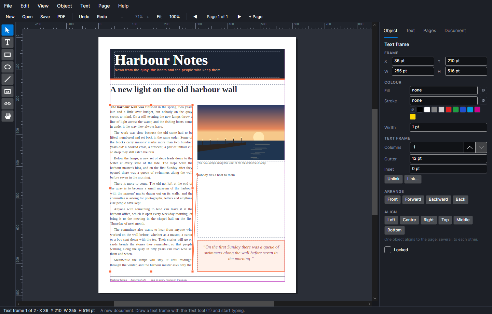

# AVAPageStream

A desktop publishing program for Windows, macOS and Linux, built with .NET 10 and Avalonia. It re-imagines
PageStream, the frame-based page layout program many people first used on the Amiga: you draw frames on a page, pour
text into them, link them so a story flows from column to column and page to page, and print exactly what you see.



## What it does

- **Pages and master pages.** Letter, Legal, Tabloid, A3, A4, A5, B5 or any size, portrait or landscape, with
  margins and column guides. Each page uses a master page, and what is on the master (a footer, a rule, a logo) is
  drawn under every page that uses it. Add and delete pages from the Pages tab, and drag them to reorder.
- **Frames.** Text frames, pictures, rectangles (with rounded corners), ellipses and lines, each with a fill and a
  stroke. A picture fits its frame four ways, and can be slid inside it (Alt+drag) to crop a different part into view. Move, resize and nudge them, line them up, bring them forward or send them back, duplicate, lock, copy and
  paste.
- **Text that flows.** A story pours through every frame in its chain, column by column, and reflows as you type or
  resize a frame. A frame whose story doesn't fit shows a red ⊞ mark; click it, then another frame, and the text flows
  on into that one, on the same page or another.
- **Type.** Liberation Serif and Liberation Sans come built in, so a document looks the same on every computer, and
  any installed font can be used too. Set size, bold, italic, underline, colour and tracking; alignment (left,
  centre, right, justified), leading, indents and space before and after; and paragraph styles (Body, Heading,
  Subheading, Caption, and your own) that update every paragraph using them when you redefine or rename one.
- **Editing in place.** Type straight into the page: the caret moves through the whole story, across frames, with
  word and line movement, Page Up and Page Down from frame to frame, selection by Shift, dragging, double-click (word)
  and triple-click (paragraph). Only the story being typed in is laid out again, so long documents stay quick.
- **Rulers, guides and snapping.** Rulers in points, picas, inches, millimetres or centimetres; drag a guide out of
  a ruler (and back to remove it). Moving, resizing and drawing snap to the margins, columns, page edges and centre,
  and the guides.
- **Measures in any unit.** Every box takes `54`, `0.75in`, `4p6`, `20mm` or a sum like `1in + 6pt`.
- **Undo** for every change, all the way back. A run of typing or nudging is one step.
- **PDF and PNG.** Export all the pages, this page or a range (`1-3, 5`) as a vector PDF with its fonts embedded, or
  as PNGs at 72 to 600 dpi. They are drawn
  by the same code as the screen, so line breaks and positions match exactly.
- **Self-contained files.** A `.avps` document carries its pictures with it.

| Styling text from the Text tab | A story too long for its frame | The exported PDF |
| --- | --- | --- |
|  |  |  |


## Using it

| Tool | Key | |
| --- | --- | --- |
| Select | V | Click to select (Shift adds), drag to move, drag a handle to resize (Shift keeps the shape), double-click a text frame to type in it. |
| Text | T | Drag a frame and start typing, or click in a frame to put the caret there. |
| Rectangle, Ellipse, Line | R, E, L | Drag to draw. Shift makes squares and circles, and keeps lines at 45°. |
| Picture | P | Drag a frame, then pick an image (PNG, JPEG, GIF, BMP or WebP). Click a picture to replace its image. |
| Link | K | Click a text frame, then the frame its text should flow on into. Alt+click takes a frame out of its chain. |
| Hand | H, or hold Space | Drag to scroll. |

Arrows nudge by 1 pt (Shift: 10 pt). Escape leaves the text, then clears the selection. Ctrl+wheel zooms; Ctrl+0
fits the page and Ctrl+1 shows it at actual size; the scroll bars, the wheel (Shift for sideways) and the Hand tool
scroll; Page Up and Page Down change page (or, in text, move the caret a frame). Ctrl+B, Ctrl+I and Ctrl+U set
bold, italic and underline. Ctrl+D duplicates; Ctrl+[ and Ctrl+] send back and bring forward. Ctrl+E exports a PDF.

## Download

Every push to `main` builds the program for Windows, macOS and Linux (Intel/AMD and ARM) and attaches it to the
[latest release](../../releases/tag/latest). Unzip or untar and run `AVAPageStream` (`AVAPageStream.exe` on
Windows). Open a document straight away with `AVAPageStream brochure.avps`.

## Building

Needs the .NET 10 SDK.

```bash
dotnet build AVAPageStream.slnx
dotnet test AVAPageStream.slnx
dotnet run --project src/AVAPageStream
```

The design, and what is still to come (facing pages, text wrap, groups, Bézier paths, a story editor, find and
replace, printing), is in [AVAPageStream_Spec.md](AVAPageStream_Spec.md).

## Licence

MIT: see [LICENSE](LICENSE). The bundled Liberation fonts are under the SIL Open Font License; see
[src/AVAPageStream/Assets/Fonts/LICENSE-Liberation.txt](src/AVAPageStream/Assets/Fonts/LICENSE-Liberation.txt).

AVAPageStream is a new program written from scratch in tribute to PageStream. It is not affiliated with Soft-Logik
Publishing or Grasshopper LLC, and it does not read PageStream documents.
