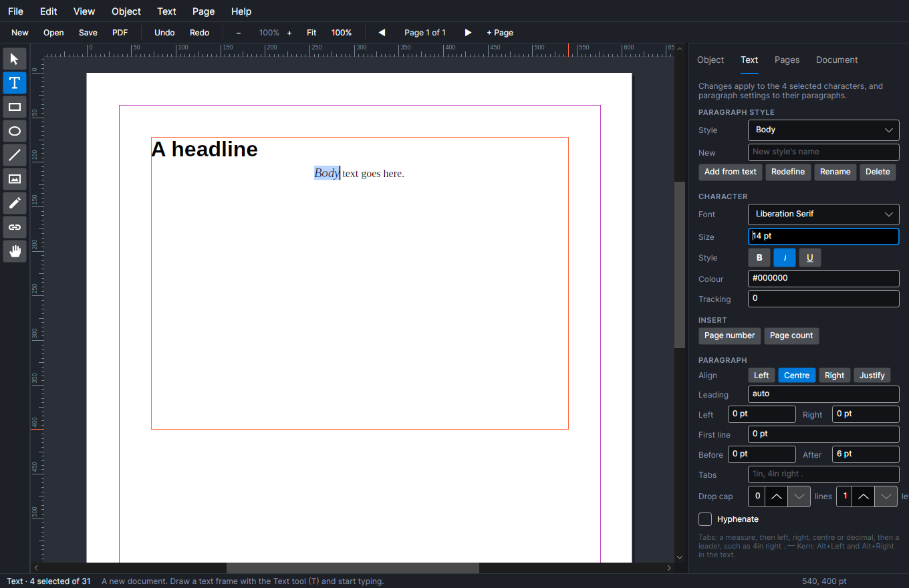
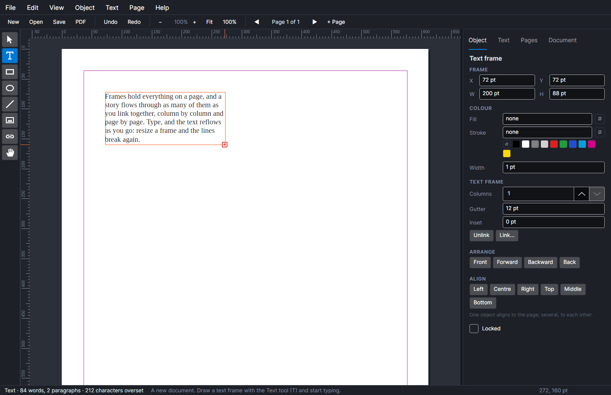
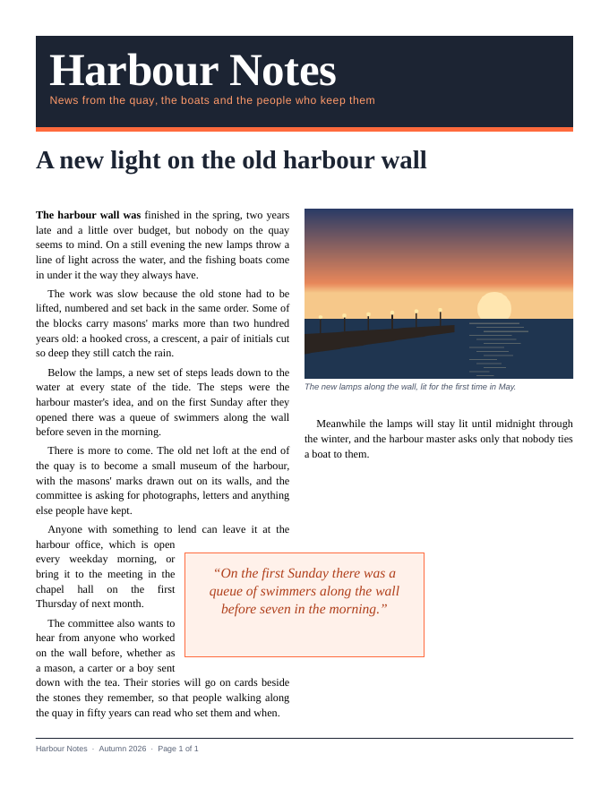
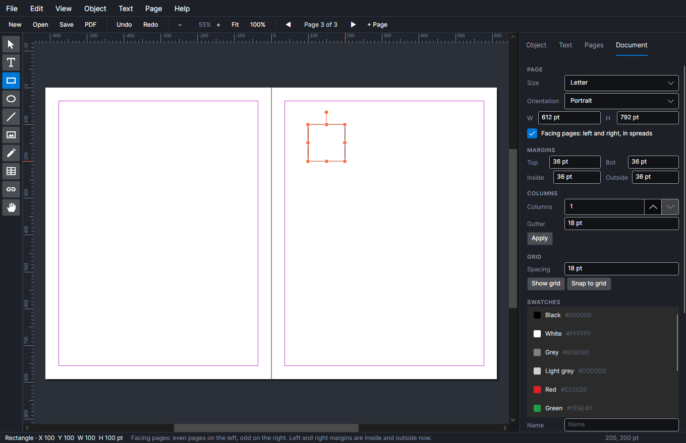
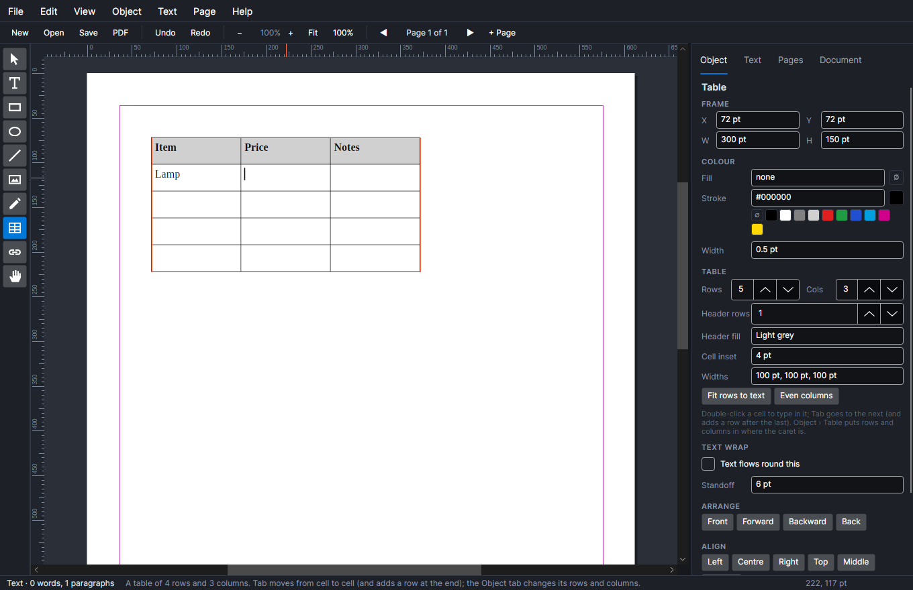
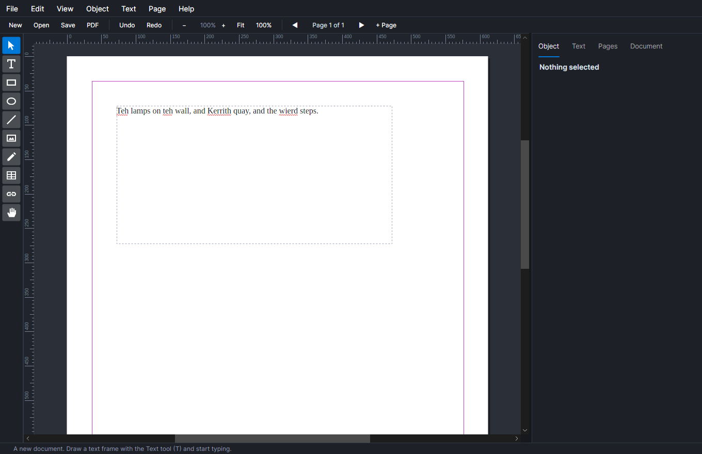
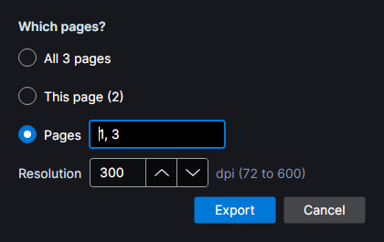

# AVAPageStream

A desktop publishing program for Windows, macOS and Linux, built with .NET 10 and Avalonia. It re-imagines
PageStream, the frame-based page layout program many people first used on the Amiga: you draw frames on a page, pour
text into them, link them so a story flows from column to column and page to page, and print exactly what you see.


**[USERGUIDE.pdf](USERGUIDE.pdf)** is the guide to using it: setting up a document, frames and flowing text, type,
pictures, tables, colour, spelling, and exporting and printing, with a picture for each. It is made from
[USERGUIDE.md](USERGUIDE.md), which reads as well on GitHub.

## What it does

- **Pages and master pages.** Letter, Legal, Tabloid, A3, A4, A5, B5 or any size, portrait or landscape, with
  margins and column guides. Each page uses a master page, and what is on the master (a footer, a rule, a logo) is
  drawn under every page that uses it. Put a page-number field in a master's footer and each page shows its own
  number (and the page count, if you like: "Page 3 of 12"). Add and delete pages from the Pages tab, and drag them to reorder.
- **Facing pages and spreads.** Work on left and right pages side by side, with inside and outside margins, left
  and right master pages, and masters with their own margins and columns.
- **Frames.** Text frames, pictures (PNG, JPEG, GIF, BMP, WebP, SVG kept as vector, EPS and PDF pages), tables, rectangles
  (with rounded corners), ellipses, lines (with arrowheads), and polygons and Bézier curves drawn with the Pen, each
  with a fill and a stroke. Turn any of them to any angle,
  group them, and edit a path's points and handles. A picture fits its frame four ways, and can be slid inside it (Alt+drag) to crop a different part into view. Move, resize and nudge them, line them up, bring them forward or send them back, duplicate, lock, copy and
  paste, and space them evenly across or down.
- **Text wrap.** Set any picture, box or frame to wrap, with a standoff, and the text under it flows round it,
  on both sides if there is room: a pull quote across the gutter pushes both columns aside. Circles and closed shapes
  can wrap by their outline.
- **Text that flows.** A story pours through every frame in its chain, column by column, and reflows as you type or
  resize a frame. A frame whose story doesn't fit shows a red ⊞ mark; click it, then another frame, and the text flows
  on into that one, on the same page or another.
- **Type.** Liberation Serif and Liberation Sans come built in, so a document looks the same on every computer, and
  any installed font can be used too. Set size, bold, italic, underline, small caps, superscript and subscript,
  colour, tracking and kerning; alignment
  (left, centre, right, justified), leading, indents, space before and after, tab stops (left, right, centre and
  decimal, with leaders), drop caps and hyphenation; and paragraph styles (Body, Heading, Subheading, Caption, and
  your own) that update every paragraph using them when you redefine or rename one. Character styles (Emphasis,
  Strong, Small caps and your own) lay their settings over the paragraph's.
- **Long documents.** Keep a heading with the next paragraph, keep a paragraph's lines together, and widow and orphan
  control; sections of page numbering (i, ii, iii, then 1, 2, 3, or A-1 with a prefix); layers, each shown or
  hidden, locked, and printed or not; footnotes at the foot of the column; tables that run on from page to page
  with their header rows repeated; and a baseline grid for lines to line up on across columns.
- **Text on a path**: type set along any curve or polyline, turned to follow it.
- **Effects**: linear and radial gradients of any number of colours, opacity and blend modes, drop shadows and
  glows, and rounded or cut corners, on anything on the page; object styles that keep a look by name and update
  everything in it; rules above and below paragraphs, in their styles; and text turned into outlines.
- **Linked pictures**, read from their files and updated when the files change, or kept in the document.
- **Printing to the edge**: a bleed, and PDFs with crop marks and trim and bleed boxes; CMYK PDFs, and PDF/X-4 for
  print shops, with an output intent of its own CMYK profile.
- **Preflight and packaging**: a list of what would go wrong in print (overset text, missing or low-resolution
  pictures, artwork short of the bleed, missing fonts), each a click from the problem; and a package folder of the
  document, its linked pictures and fonts, with a report.
- **Autosave**: unsaved work is copied every two minutes and offered back after a crash.
- **Colour swatches.** Pick colours by name from the document's swatches, at any tint; change a swatch and
  everything in it changes. Swatches can be CMYK, and spot inks, and the Document tab lists the inks a job needs.
- **Tables** of rows and columns, each cell with text of its own: Tab from cell to cell, a shaded header row, rows
  fitted to their text.
- **Spelling**, in American or British English: misspelt words underlined as you type, and a spelling check with
  suggestions, Ignore all and your own dictionary.
- **The story editor** (Ctrl+Shift+E) shows a story as plain text in a window of its own for writing and
  correcting, changing the page as you type. Text copied and pasted within the program keeps its formats.
- **Find and replace** through every story, page by page, with match case and whole word; Replace all is one undo.
- **Place text.** Pour a plain text or Markdown file into a frame: Markdown headings, paragraphs, lists, quotes,
  bold and italic come in as styled paragraphs and flow on through the chain.
- **Editing in place.** Type straight into the page: the caret moves through the whole story, across frames, with
  word and line movement, Page Up and Page Down from frame to frame, selection by Shift, dragging, double-click (word)
  and triple-click (paragraph). Only the story being typed in is laid out again, so long documents stay quick.
- **Rulers, guides, grid and snapping.** Rulers in points, picas, inches, millimetres or centimetres; drag a guide out
  of a ruler (and back to remove it). Moving, resizing and drawing snap to the margins, columns, page edges and
  centre, the guides, and (if you like) a document grid.
- **Measures in any unit.** Every box takes `54`, `0.75in`, `4p6`, `20mm` or a sum like `1in + 6pt`.
- **Undo** for every change, all the way back. A run of typing or nudging is one step.
- **PDF and PNG.** Export all the pages, this page or a range (`1-3, 5`) as a vector PDF with its fonts embedded,
  bookmarks from the headings, links from the contents and web addresses, and its title and author, in RGB or in
  CMYK for a press (swatches' own inks, spot colours as their own), or as PNGs at 72 to 600 dpi. They are drawn
  by the same code as the screen, so line breaks and positions match exactly.
- **Print and booklets.** Print straight from the program (through the system's printing), and print or export a
  booklet: pages paired on each sheet in the order that folds into a stapled booklet.
- **A table of contents** from your headings' paragraph styles, with dot leaders to the page numbers.
- **Templates.** Save any document as a template, and start new ones from it, or from the built-in newsletter and
  booklet.
- **Self-contained files.** A `.avps` document carries its pictures with it.

| Styling text from the Text tab | A story too long for its frame | The exported PDF |
| --- | --- | --- |
|  |  |  |



| A table, typed into from cell to cell | Spelling checked as you type |
| --- | --- |
|  |  |



## Using it

| Tool | Key | |
| --- | --- | --- |
| Select | V | Click to select (Shift adds), drag to move, drag a handle to resize (Shift keeps the shape), double-click a text frame to type in it. |
| Text | T | Drag a frame and start typing, or click in a frame to put the caret there. |
| Rectangle, Ellipse, Line | R, E, L | Drag to draw. Shift makes squares and circles, and keeps lines at 45°. |
| Picture | P | Drag a frame, then pick an image (PNG, JPEG, GIF, BMP or WebP). Click a picture to replace its image. |
| Link | K | Click a text frame, then the frame its text should flow on into. Alt+click takes a frame out of its chain. |
| Hand | H, or hold Space | Drag to scroll. |
| Table | G | Drag a box for a table; Tab moves from cell to cell. |
| Pen | B | Click for corners, drag for curves; click the first point to close the shape, or double-click to finish. Double-click a path with Select to move its points. |

Arrows nudge by 1 pt (Shift: 10 pt). Escape leaves the text, then clears the selection. Ctrl+wheel zooms; Ctrl+0
fits the page and Ctrl+1 shows it at actual size; the scroll bars, the wheel (Shift for sideways) and the Hand tool
scroll; Page Up and Page Down change page (or, in text, move the caret a frame). Ctrl+B, Ctrl+I and Ctrl+U set
bold, italic and underline; Alt+Left and Alt+Right kern. Ctrl+D duplicates; Ctrl+G groups and Ctrl+Shift+G
ungroups; Ctrl+[ and Ctrl+] send back and bring forward; drag the round handle above a selection to turn it (Shift:
15° steps). Ctrl+F finds and replaces. Ctrl+E exports a PDF.

## Download

Every push to `main` builds the program for Windows, macOS and Linux (Intel/AMD and ARM) and attaches it to the
[latest release](../../releases/tag/latest). Unzip or untar and run `AVAPageStream` (`AVAPageStream.exe` on
Windows). Open a document straight away with `AVAPageStream brochure.avps`.

## Building

Needs the .NET 10 SDK.

```bash
dotnet build AVAPageStream.slnx
dotnet test AVAPageStream.slnx
dotnet run --project src/AVAPageStream
```

The design of all of it is in [AVAPageStream_Spec.md](AVAPageStream_Spec.md). EPS pictures, text and all, are drawn
as vector by AVAPageStream's own PostScript interpreter; the few it can't read are shown by
[Ghostscript](https://ghostscript.com) when it is installed, otherwise by the colour or grey preview they carry.
Placed PDF pages are read and drawn as vector by its own PDF reader, which shares the interpreter's graphics and
fonts, opens protected PDFs, and decodes scanned pictures (CCITT fax, JBIG2, JPEG 2000) with decoders of its own. Liberation Mono is bundled too, for EPS and PDF files set in Courier.

## The user guide

`USERGUIDE.md` is the guide for someone using the program rather than reading about it; `USERGUIDE.pdf` is made from
it by `./make-guide.sh` (with `Tools/GuideBuilder`, which needs only the .NET SDK) and kept in the repository, so
anyone wanting the guide doesn't have to build it. Its pictures in `docs/images/guide` come from the window tests:

```bash
AVAPAGESTREAM_SHOTS=/tmp/shots dotnet test AVAPageStream.slnx --filter "FullyQualifiedName~Guide_"
for f in /tmp/shots/guide-*.png; do cp "$f" "docs/images/guide/${f##*/guide-}"; done
./make-guide.sh
```

Edit the Markdown, never the PDF. A change to the program wants a line in `USERGUIDE.md`, and the PDF made again.

## Licence

MIT: see [LICENSE](LICENSE). The bundled Liberation fonts are under the SIL Open Font License; see
[src/AVAPageStream/Assets/Fonts/LICENSE-Liberation.txt](src/AVAPageStream/Assets/Fonts/LICENSE-Liberation.txt). The
hyphenation patterns in [src/AVAPageStream.Core/Hyphenation](src/AVAPageStream.Core/Hyphenation) are Gerard D.C.
Kuiken's, from the hyph-utf8 package, and may be copied freely with their notice (in the files). The spelling word
lists in [src/AVAPageStream.Core/Spelling](src/AVAPageStream.Core/Spelling) are from Kevin Atkinson's SCOWL, under
the notice in [SCOWL-Copyright.txt](src/AVAPageStream.Core/Spelling/SCOWL-Copyright.txt). Adobe's predefined
CMaps, for Asian text in placed PDFs, are bundled from
[cmap-resources](https://github.com/adobe-type-tools/cmap-resources) under its BSD licence, in
[src/AVAPageStream.Core/CMaps/LICENSE.md](src/AVAPageStream.Core/CMaps/LICENSE.md). SVG is drawn by
[Svg.Skia](https://github.com/wieslawsoltes/Svg.Skia) (MIT).

AVAPageStream is a new program written from scratch in tribute to PageStream. It is not affiliated with Soft-Logik
Publishing or Grasshopper LLC, and it does not read PageStream documents.
