# AVAPageStream User Guide

## Getting started

AVAPageStream is a desktop publishing program: newsletters, leaflets, booklets, posters, menus, programmes and
anything else that is a page of words and pictures laid out with care. You draw frames on a page, pour text into
them and link them so the text flows from frame to frame, then export a PDF or print it.

There is nothing to install. Download the file for your computer from the releases page, unpack it and run it: the
.NET runtime and everything else it needs are inside the one file.

- On Linux and macOS the archive keeps the executable bit. If it goes missing on the way, `chmod +x AVAPageStream`.
- macOS will want the file cleared from quarantine before it opens something downloaded from the web.
- To open a document straight away, give it on the command line: `AVAPageStream newsletter.avps`.

Your work is saved in `.avps` files. A document file holds everything, its pictures included, so it opens the same
on another computer. Liberation Serif and Liberation Sans are built into the program for the same reason: text set
in them looks the same everywhere. You can use the fonts installed on your computer too, but whoever opens the file
needs them as well.

## The window

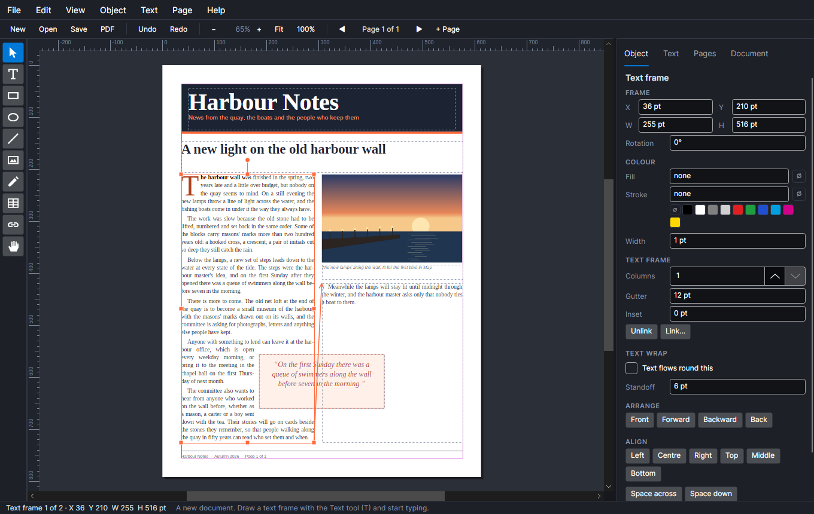

Down the left is the **toolbox**: the tools for selecting, typing, drawing and moving about (each has a key, shown
when you hover over it). In the middle is the **page**, on a grey pasteboard, with **rulers** along the top and left
and scroll bars along the right and bottom. Down the right is the **side panel**, in four tabs:

- **Object**: the selected object's position and size, colours, and everything else about it.
- **Text**: fonts and type, paragraph settings, and paragraph styles.
- **Pages**: the pages and the master pages.
- **Document**: page size, margins, columns, the grid, colour swatches, spelling and units.

The **tool bar** above the page holds the things you reach for most: new, open, save and PDF, undo and redo, zoom,
and moving between pages. The **status bar** along the bottom says what is selected (with its position and size),
what just happened, and where the mouse is on the page.

The pasteboard is yours to work on. Leave things half on and half off the page while you decide; only what is on
the page is printed or exported.

**Moving about.** The mouse wheel scrolls (Shift+wheel sideways), Ctrl+wheel zooms in and out about the mouse,
Ctrl+0 fits the page in the window and Ctrl+1 shows it at actual size. Hold Space, or use the Hand tool (H), and
drag to slide the page about. Page Up and Page Down go to the previous and next page.

**Measures** can be typed in any unit, whatever the document's unit is: `54`, `0.75in`, `20mm`, `2.5cm`, `4p6` (4
picas and 6 points) or `18pt`, and simple sums such as `1in + 6pt`. A box shows the measure back in the document's
unit, which you choose at the foot of the Document tab.

## Setting up a document

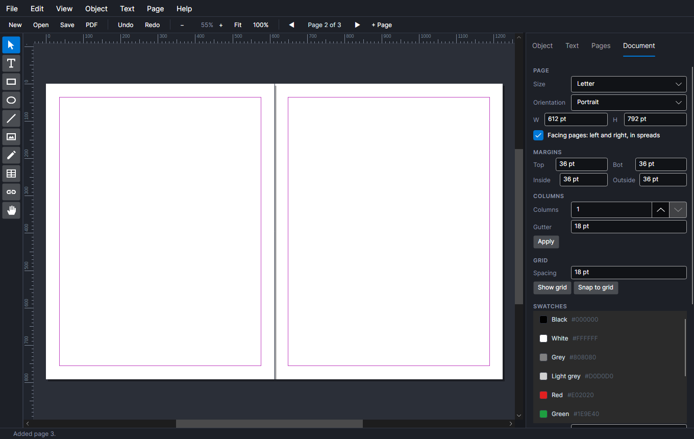

A new document is one Letter page with half-inch margins and one column. Change it in the **Document** tab:

- **Size**: Letter, Legal, Tabloid, A3, A4, A5, B5, or type your own width and height. **Orientation** turns it.
- **Margins** and **Columns** (with the **Gutter** between them) are the guides drawn on every page: margins in
  magenta, columns in violet. They are only guides, for snapping to; text frames are what text flows in.
- **Bleed** is how far artwork may run off the edge of the page, for printing to the edge: 9 pt (an eighth of an
  inch) or 3 mm is usual. It is drawn as a red dashed line round the page, and anything reaching past the page's
  edge shows out to it. See *Printing to the edge* below.
- **Baseline grid**: a **Spacing** (usually the body text's leading, such as 14pt) and the **First line**, down
  from the top of the page (the top margin, if left empty). Paragraphs set to align to it sit their lines on it, so
  lines in neighbouring columns line up. It is drawn in faint blue with the guides.
- **Apply** puts the size, bleed, margins, columns and baseline grid into effect, as one step you can undo.
- **Title** and **Author**, under PDF, go into the document's PDFs (the title is the file's name if left empty).

Tick **Facing pages** for anything that will be printed both sides and bound: a booklet, a magazine, a book. Odd
pages are then right-hand pages and even pages left-hand ones, page 1 on its own on the right, the way a printed
book opens. The view shows a **spread**, the left and right pages side by side with the spine between, and you work
on either by clicking it. The left and right margins become the **inside** (by the spine) and the **outside**, so a
left page has them the other way round.

## Pages and master pages

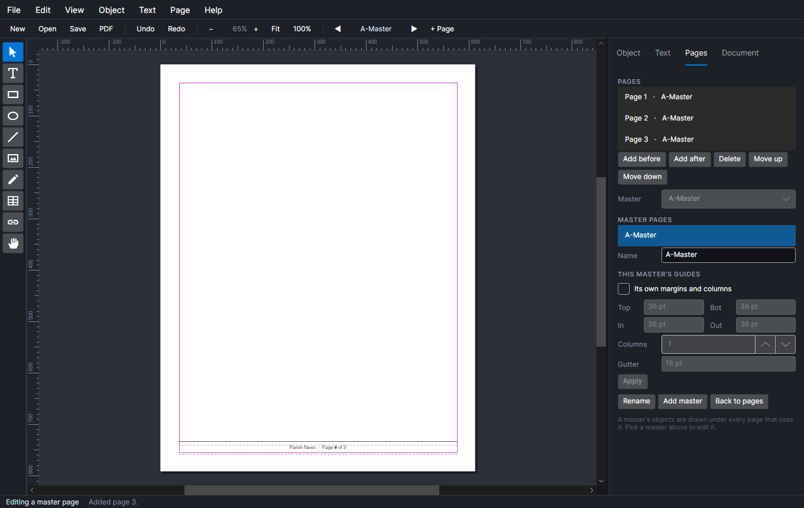

The **Pages** tab lists the pages. **Add before** and **Add after** put a page in beside the one shown, **Delete**
takes the one shown out (never the last), and **Move up** and **Move down**, or dragging a page in the list, change
the order. Click a page to show it.

Every page uses a **master page**, "A-Master" to start with. Whatever is on a master is drawn under every page that
uses it: a running head, a footer, a rule, a logo, a page number. Pick a master in the list of master pages to edit
it (or Page › Edit this page's master); what you draw there appears on its pages, which can't select it. Choose a
page's master under the page list, or none.

**Page numbers.** Put a text frame on the master, type the words round it, and choose Text › Insert page number
(Ctrl+Shift+3). On the master it shows as "#", and on each page that page's own number. Text › Insert page count
adds the number of pages, for "Page 3 of 12". A page number in a frame on a page itself counts from the page the
story starts on.

**Sections of numbering.** Front matter numbered i, ii, iii and the chapters from 1, or an appendix numbered A-1,
A-2: show the page a section starts on, and in the Pages tab tick **Start a section of numbering here**. Then set
what its first page is numbered (**Starts at**), how (**Numbers**: 1, 2, 3; i, ii, iii; I, II, III; a, b, c or A, B,
C) and a **Prefix**. Every page until the next section counts on from there. Page numbers, the page list, the status
bar ("Page 5 (iii) of 40") and a table of contents all use the section's numbers.

A master can have **its own margins and columns** (This master's guides, in the Pages tab), for the pages that use
it: an index set in three columns, say, in a document of two. In a facing document each master has a left side and
a right side, drawn under left and right pages, so page numbers can sit on the outside corners of both.

## Layers

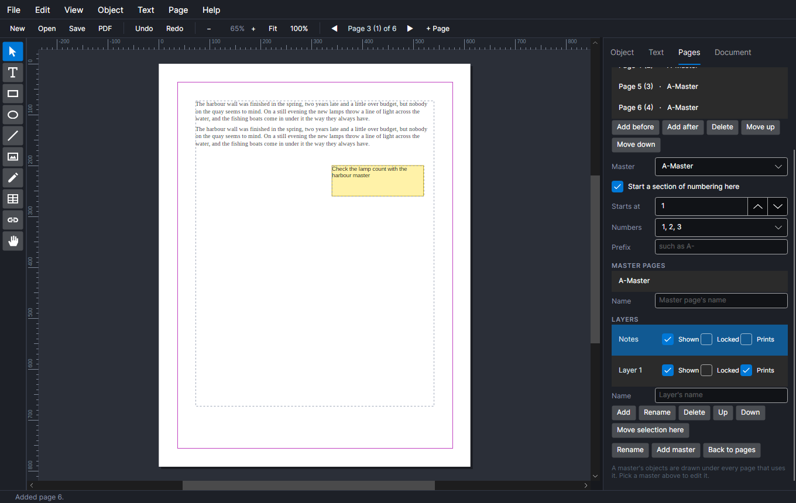

The Pages tab's **Layers** list holds the document's layers, top first. Every object is on one, and the layers are
drawn in order, so a layer of notes or a watermark can sit above or below everything else whatever order things were
drawn in. Each layer has three ticks:

- **Shown**: untick it to hide the layer's objects, on screen and in print. A hidden layer's objects don't wrap text.
- **Locked**: its objects are drawn but can't be clicked, dragged or selected, so artwork can't be nudged by
  mistake.
- **Prints**: untick it for a layer of notes or guides you want to see but not print or export.

Click a layer to make it the one new objects go on. Type a name and click **Add** for a new layer, or **Rename**;
**Delete** puts the layer's objects onto the layer below it (the last layer can't be deleted). **Up** and **Down**
change the order, and **Move selection here** moves the selected objects onto the picked layer.

## Drawing

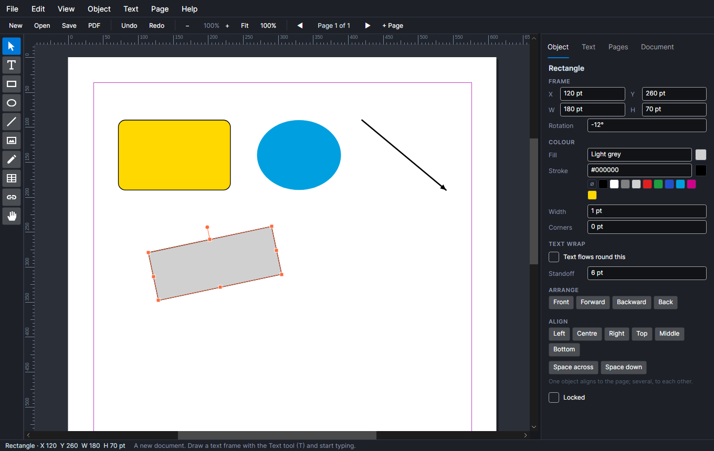

| Tool | Key | |
| --- | --- | --- |
| Select | V | Click to select, Shift+click to add or take away, drag across the page to select everything inside. |
| Text | T | Drag a text frame and type in it; click in a frame to put the caret there. |
| Rectangle | R | Drag to draw. Shift makes a square. |
| Ellipse | E | Drag to draw. Shift makes a circle. |
| Line | L | Drag to draw. Shift keeps it to 45° steps. |
| Picture | P | Drag a frame, then pick a picture for it. |
| Pen | B | Polygons and curves: see below. |
| Table | G | Drag a table: see Tables. |
| Link | K | Link text frames so text flows from one to the next. |
| Hand | H | Drag to slide the page about (or hold Space with any tool). |

**Moving and resizing.** Drag an object to move it, or one of the eight handles round it to resize it (Shift keeps
its shape). The arrow keys nudge the selection by a point, ten with Shift. Moving and resizing snap to the margins,
columns, guides and the page's edges and middle (see Rulers, guides and the grid). Or type exact figures into
**X**, **Y**, **W** and **H** in the Object tab, in any unit.

**Colour.** Fill and stroke are set in the Object tab: type a colour's name, a value like `#2050D0`, or `none`, or
click a swatch below them (Shift+click for the stroke). **Width** is the stroke's thickness. A new object is drawn
with the fill and stroke last set on one of its kind. Rectangles have rounded **Corners**; lines have **Arrowheads**
at either end.

**Turning.** Drag the round handle above a selected object to turn it about its middle (Shift for 15° steps), or
type the angle into **Rotation**. A turned text frame still takes typing and clicks the right way up for it.

**Arranging.** Objects are drawn in order, the last on top. Object › Bring to front and Send to back, or Bring
forward and Send backward (Ctrl+] and Ctrl+[, with Shift for all the way), change the order. The Object tab's
**Align** buttons line selected objects up by their edges or middles (one object, with the page); **Space across**
and **Space down** spread three or more evenly.

**Grouping.** Ctrl+G makes the selected objects one group, which moves, resizes and arranges as one; Ctrl+Shift+G
takes it apart. You can still type in a text frame inside a group: double-click it.

**Copying and deleting.** Ctrl+D duplicates the selection a little down and to the right; Ctrl+C and Ctrl+V copy and
paste it, on this page or another; Delete takes it away. **Lock** (in the Object tab or menu) keeps an object from
being moved, resized or deleted by accident.

## Text frames and how text flows

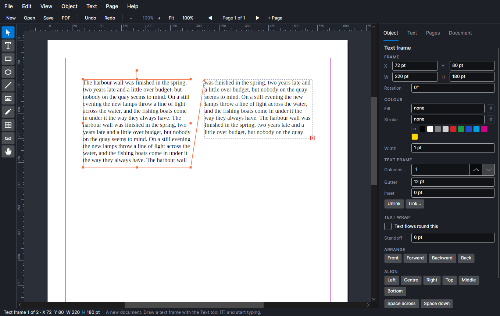

Text lives in **stories**. A story flows through one text frame, or through a chain of them linked together, column
by column and frame by frame, and reflows whenever you type, resize a frame or change the type.

Draw a text frame with the Text tool and start typing. When there is more text than the frame holds, a small red
square with a plus in it appears at its bottom-right corner and the status bar says how many characters are **overset**: there, but not
showing. To give the text somewhere to go:

1. Draw another text frame, empty, on this page or any other.
2. Click the red mark with the Select tool (or pick the Link tool, K, and click the first frame).
3. Click the new frame. The text flows on into it.

When a linked frame is selected, arrows show the way the text goes from frame to frame. Link as many frames as you
like; a story can run through a whole book. **Unlink** in the Object tab (or Alt+click with the Link tool) takes a
frame out of its chain, and the text flows on through the rest.

A frame can have several **Columns** of its own, with a **Gutter** between them, and an **Inset** that keeps the text
in from its edges (Object tab › Text frame).

## Typing and editing

Double-click a text frame with Select, or click in it with the Text tool, to put the caret in it. The caret moves
through the whole story, from frame to frame and page to page; the view follows it.

| Keys | |
| --- | --- |
| Arrows, Home, End | Move by a character or line, to the start or end of the line. |
| Ctrl+Left, Ctrl+Right | Move by a word. |
| Ctrl+Home, Ctrl+End | The start or end of the story. |
| Page Up, Page Down | The start of the previous or next frame in the chain. |
| Shift with any of those | Select as you go. |
| Double-click, triple-click | Select a word, a paragraph. |
| Ctrl+A | Select the whole story. |
| Backspace, Delete | Delete a character (with Ctrl, a word). |
| Enter | A new paragraph. |
| Escape | Leave the text; the frame stays selected. |

Cut, copy and paste work on the text as you would expect. Text copied and pasted within AVAPageStream keeps its fonts,
sizes and styles; text from other programs comes in plain, taking the look of where it lands.

## Formatting text

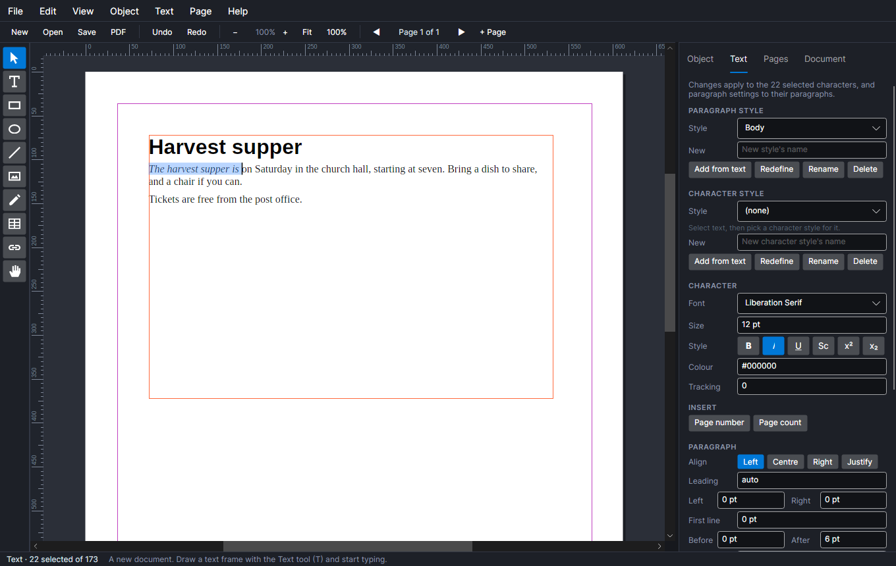

The **Text** tab sets the type of what is selected. With the caret in some text, its character settings change the
selected characters (or, with nothing selected, the next you type) and its paragraph settings change the paragraphs
the selection touches. With text frames selected and no caret, they change all the frames' text.

- **Font**, **Size**, and **B**, **I** and **U** (Ctrl+B, Ctrl+I, Ctrl+U) for bold, italic and underline.
- **Sc** sets small capitals; **x²** and **x₂** superscript and subscript.
- **Colour** of the text, by a swatch's name or a value.
- **Tracking** loosens or tightens the spacing, in thousandths of an em. To kern a pair of letters by hand, put the
  caret between them and press Alt+Left or Alt+Right (Shift for bigger steps).
- **Align**: left, centre, right or justified.
- **Leading**: the distance from one line to the next, or `auto` (120% of the largest type on the line).
- **Left** and **Right** indents, the **First line** indent (a negative one makes a hanging indent), and space
  **Before** and **After** the paragraph.

### Paragraph styles

A paragraph style is a named set of all of that: Body, Heading, Subheading and Caption to start with. Pick one from
**Style** to set the paragraph the caret is in. Styles are what keep a long document consistent, and what make it
quick to change: to make every heading a size bigger, change one heading, then **Redefine**, and they all follow.

- **Add from text**: type a name and click it, and the paragraph the caret is in becomes a new style.
- **Rename** and **Delete** do as they say; deleting a style leaves its paragraphs looking as they did.

### Character styles

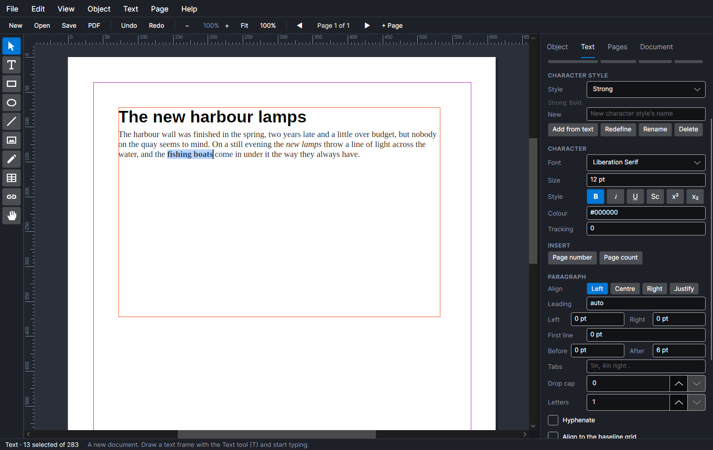

A character style is a named set of a few character settings, laid over whatever paragraph style the text is in:
**Emphasis** (italic), **Strong** (bold) and **Small caps** to start with. Select some words and pick one from the
character **Style** list; pick **(none)** to take it off again. Because it holds only the settings it changes,
Emphasis in a heading is italic heading type, and in body text italic body type, and changing the paragraph's style
keeps it.

- **Add from text**: format some words the way you want, type a name and click it. The new style is what those words
  have that their paragraph's style doesn't, shown beneath the list.
- **Redefine** makes the style what the selected words are now, and every word using it follows.
- **Rename** and **Delete**; deleting a character style puts its words back to their paragraph's type.

Placed Markdown uses Strong for `**bold**` and Emphasis for `*italic*`.

**Align to the baseline grid** (at the foot of the Text tab) puts the paragraph's lines on the document's baseline
grid (set in the Document tab): each line drops to the next grid line at or below where it would be. Tick it in the
Body style and redefine, and every column's lines line up across the page, however the headings between them are
spaced.

### Keeping text together

Four settings at the foot of the Text tab stop awkward breaks between columns and pages, for the paragraph the caret
is in (or for a paragraph style, by redefining it):

- **Keep with the next paragraph**: a heading never sits alone at the foot of a column; it goes on with the paragraph
  after it.
- **Keep its lines together**: the paragraph never breaks; if it doesn't fit, it all starts the next column.
- **Orphans**: at least so many of its lines at the foot of a column, or none there.
- **Widows**: at least so many of its lines at the top of the next, brought over from the column before if need be.

A paragraph already at the top of a column, or too long for any column, is never moved, so text can't vanish.

### Paragraph rules

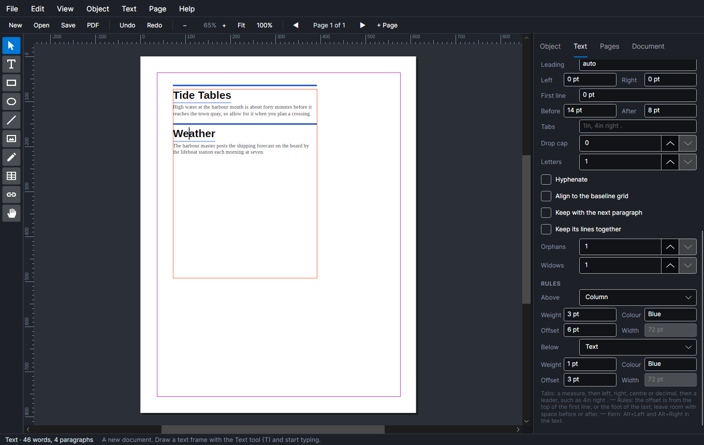

**Rules**, at the foot of the Text tab, draws a line above a paragraph's first line, below its last, or both. Pick
how long it is from **Above** or **Below**:

- **Column**: across the column, less the paragraph's indents.
- **Text**: as long as the line's text, so a short heading gets a short rule.
- **Width**: a set length, typed in **Width**, from the left indent.

**Weight** is how thick it is, **Colour** a swatch's name or a value, and **Offset** how far it stands off the top of
the first line (or the foot of the last). A rule takes no room of its own, so give the paragraph space before or after
to make room for it; at the top of a frame, where space before is dropped, a rule above sits just over the frame.
Rules are part of the paragraph's settings, so a style made or redefined from a ruled paragraph carries them: rule
the Heading style once, and every heading has them.

## Tabs, drop caps and hyphenation

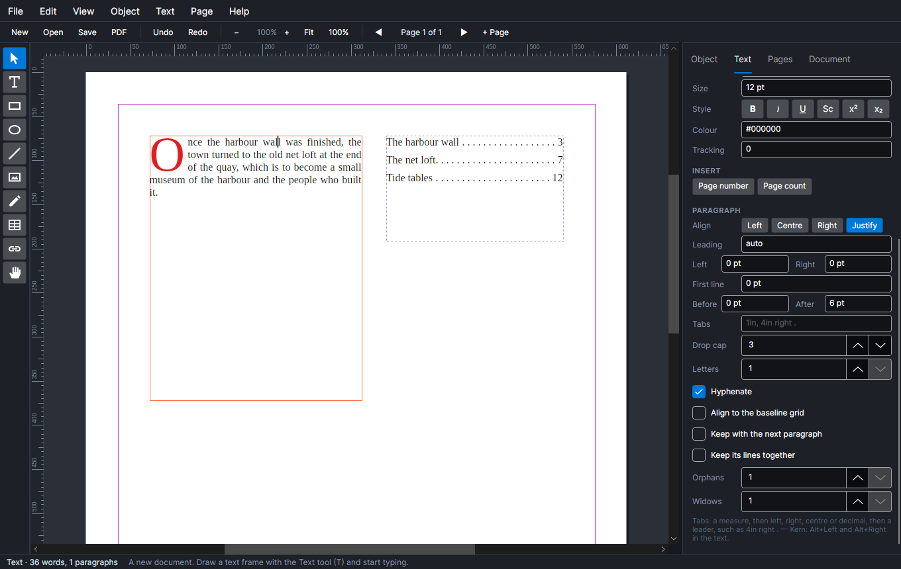

**Tabs.** Press Tab in the text and it jumps to the next tab stop: every half inch, unless the paragraph has stops of
its own. Type them in the Text tab's **Tabs** box, separated by commas: a measure, then left, right, centre or
decimal, then a leader character to fill the gap if you want one. `1in, 4in right .` puts a left tab at an inch and
a right tab at four inches with dots leading to it, as in a list of contents. Decimal tabs line figures up on their
decimal points. A hanging indent's left indent is a stop too, so a bullet, a tab and the text line up.

**Drop caps.** **Drop cap** sets how many lines deep it goes (0 or 1 for none), and **Letters** how many letters it takes. The capital stands from the last of
those lines' baseline up to the top of the first line's capitals, and the lines beside it make room.

**Hyphenation.** Tick **Hyphenate** and words are broken at the ends of lines where the hyphenation patterns allow,
with at least two letters before the break and three after it. Justified text looks far better with it.

## Placing text

Text written elsewhere doesn't need typing again. Select a text frame (or put the caret where the text should go)
and choose Object › Place text…, then pick a `.txt` or `.md` file.

- Plain text comes in a paragraph a line, in the Body style.
- **Markdown** comes in styled: `#` headings take the Heading style and `##` and smaller Subheading, paragraphs take
  Body, list items get a bullet or number on a hanging indent, quotes are indented and in italic, and `**bold**` and
  `*italic*` carry over.

What doesn't fit is overset, with the red mark showing: link more frames to flow it on.

## Pictures

Draw a frame with the Picture tool and pick a picture, or select a picture frame and choose Object › Place picture….
Click a picture with the Picture tool to replace it. Pictures can be:

- **PNG, JPEG, GIF, BMP and WebP**: the usual kinds.
- **SVG** drawings: kept as drawings, so they stay sharp at any size, on screen and in PDFs.
- **EPS** (Encapsulated PostScript): sized from the file, and drawn by AVAPageStream itself, which reads the
  PostScript in it: its shapes, lines, colours, gradients, the pictures inside it and its text, kept as vector so it
  prints sharp. Fonts the file carries (TrueType, Type 1 and Type 3) are drawn from it; fonts it only names, as
  printers have built in (Times, Helvetica, Courier and their bold and italic), are drawn with the Liberation fonts,
  made to the same widths, so the text sets as it was meant to. It reads composite and CID fonts (as Asian text and
  Unicode fonts use), CFF fonts, the Symbol and Dingbats fonts, patterns and every kind of smooth shading. For the
  rare file that uses something it can't read, [Ghostscript](https://ghostscript.com) draws it if it
  is installed, or the preview the file carries shows: in colour for the EPS files Illustrator, CorelDRAW and most Windows programs save (a TIFF preview), in grey
  for EPSI previews. With neither, it is a labelled box. The status bar says which drew it when it is placed.
- **PDF** pages: drawn by AVAPageStream's own PDF reader, as vector, so a page of a brochure, an advert from a
  client or a logo saved as PDF prints as sharp as the original. A placed PDF shows its first page; for one with
  more, choose another with **Page** in the Object tab's Picture section. The page is shown in its crop box, turned
  as the PDF says.

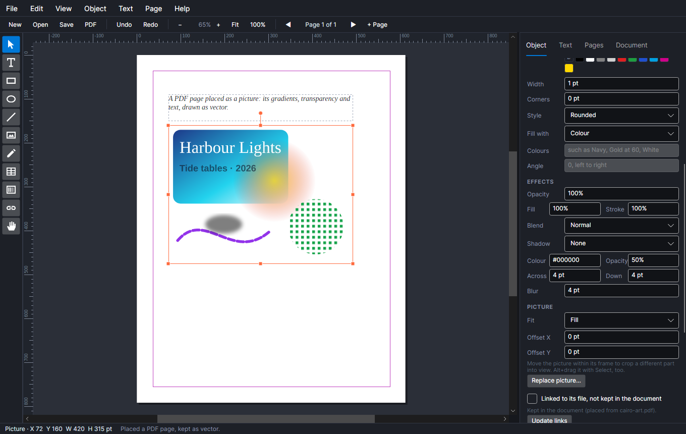

It reads what PDFs from Acrobat, InDesign, Word and LibreOffice, Chrome, cairo, Ghostscript, TeX and the rest put in
them: shapes, colours (CMYK, spot colours, ICC, Lab), gradients and meshes, patterns, transparency, blend modes and
soft masks, pictures (JPEG among them) and their masks, and text in the fonts they carry (TrueType, Type 1, CFF and
OpenType, Type 3, and composite fonts for Asian text) or name (drawn with the Liberation fonts, made to the same
widths). Stamps, filled-in form fields and other notes that print are drawn too, and layers the PDF has turned off
are left out. A damaged file is read as far as it can be. Scanned and faxed pages are drawn whichever way they were
squeezed: CCITT fax, JBIG2 (as scanners and Acrobat's "optimise" write it) and JPEG 2000, with a JPEG 2000
picture's own colours and see-through parts. Asian text in a font the PDF only names (as Japanese, Chinese and
Korean PDFs often do, with the predefined CMaps of Adobe's character collections) is drawn from a font on your
computer that has the characters, across or top to bottom as the PDF says; install one, such as Noto CJK, if it
shows nothing. The only thing left out is a JBIG2 picture coded with Huffman tables, which is rare; the status bar
says so when the page is placed.

**Protected PDFs.** A PDF protected only against copying or changing it (most are) is placed like any other. One
that needs a password to open asks for it when you place it; the password is kept in the document with the
picture, so the page can be drawn whenever the document is opened. Anyone with the document can draw the page, so
don't place a PDF whose password must stay secret in a document you'll share.

The picture is stored inside the document, so moving or deleting the original file does no harm.

**Linked pictures.** Tick **Linked to its file** in the Object tab and the picture is read from the file it was
placed from instead: the document stays small, and when the file changes (a photograph retouched, a logo redrawn),
the picture follows it the next time you come back to the window, or at once with **Update links**. Underneath, the
tab says whether the link is up to date. A linked file is looked for where it was placed from, and then beside the
document, so a folder holding a document and its pictures can be moved as a whole. If a linked file can't be found,
opening the document says so, and the picture keeps its place until you find the file or replace the picture.
Untick the box to keep a copy in the document again.

**Fit** (Object tab) decides how a picture fills its frame: **Fit** shows all of it, **Fill** fills the frame and
crops what spills over, **Stretch** fills it out of shape, and **Actual** is the picture's own size. To crop a
different part into view, Alt+drag the picture with Select, or type an **Offset**.

## Text wrap

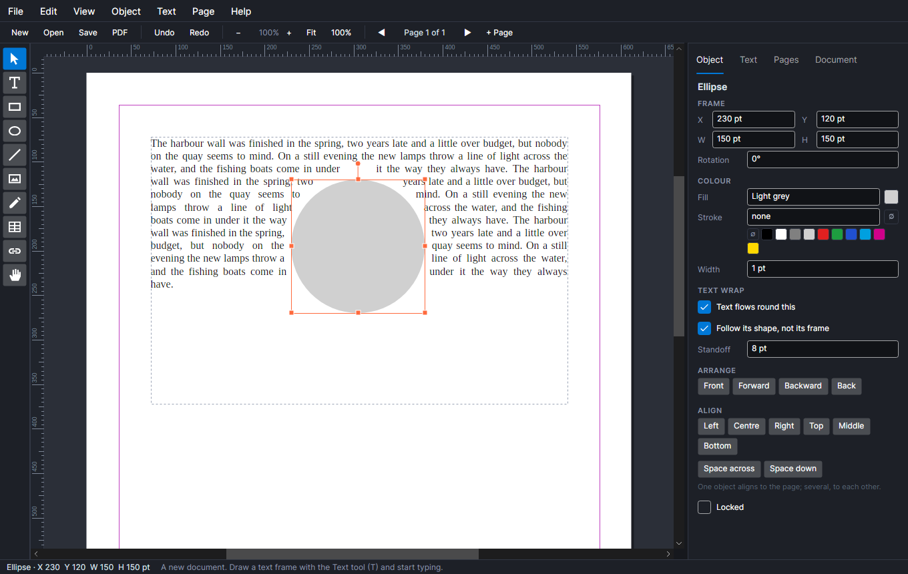

Tick **Text flows round this** for any object (a picture, a box, a frame, a shape) and the text in the frames under
it keeps out of its way, the **Standoff** from its edge. Where there is room on both sides, the text runs on either
side; where there isn't, it moves on below. For an ellipse or a closed path, **Follow its shape** makes the text hug
its outline rather than its frame.

Wrap affects only the text **under** the object, in the drawing order. So a pull quote's own text frame, sitting on
top of its tinted box, keeps its text, while the columns underneath flow round both. Use Bring forward and Send
backward to decide which is which. Objects on a master page wrap the text on every page that uses it.

## Anchored objects

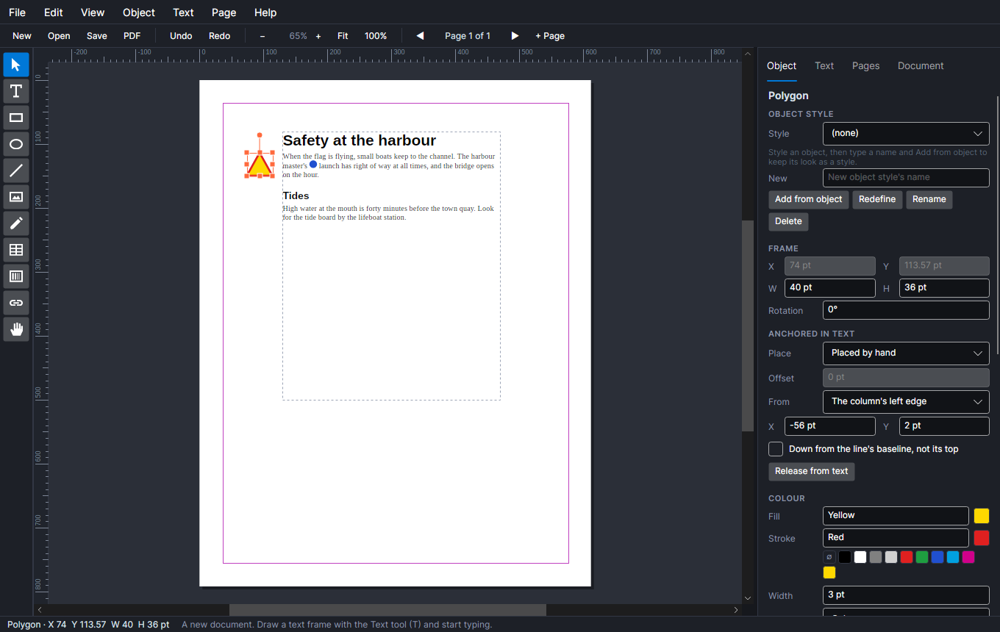

An object can be anchored in text, so that it moves with the words around it as they reflow: a picture that
belongs with its paragraph, an icon in the margin beside a heading, a symbol in the middle of a sentence.

- **In the line**: copy an object, put the caret in some text and paste, and the object goes into the line like a
  letter. The line grows to hold it. Or, with the caret in text, choose Object › Place picture… to put a picture
  there at its own size (no wider than the column).
- **Beside the text**: select an object on the page and choose Object › **Anchor to text**. It is anchored to the
  start of the line it is level with, and stays where it is against that line. Move the text and it follows.

The Object tab's **Anchored in text** section says how an anchored object is placed:

- **In the line**, raised or lowered from the baseline by its **Offset**.
- **Placed by hand**, taking no room in the line: its **X** measured from the column's left edge, its right edge,
  or where it is anchored, and its **Y** down from the top of its line (or its baseline). Drag it to place it; its
  offsets follow. Tick **Text flows round this** (Text wrap) and the text makes room for it.

Click an anchored object to select it, and change it as any other: its colour, size, picture, effects and style.
Deleting it takes its anchor out of the text, and deleting the text takes the object with it; copying text copies
its objects too. **Release from text** (in the tab or the Object menu) puts it back on the page where it is.

## Polygons and curves

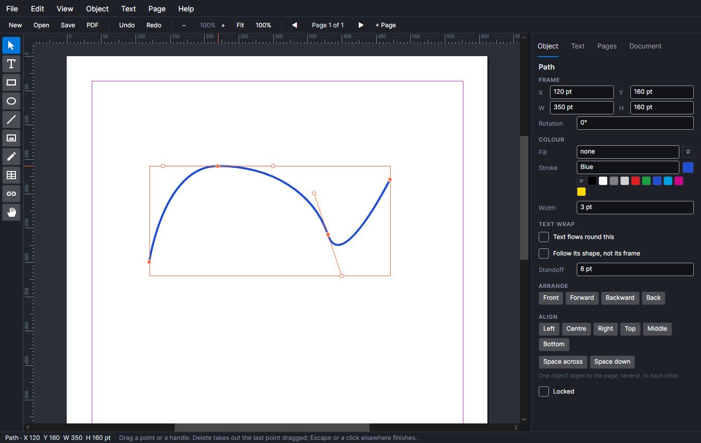

The **Pen** (B) draws shapes of your own, point by point:

- **Click** for a corner point, and **drag** for a smooth one: the handle comes out to where you let go and sets the
  curve through the point. Shift keeps a point to 45° steps from the last.
- **Click the first point** again to close the shape (only a closed shape is filled).
- **Double-click**, or press Enter, to finish an open path; Escape gives up the one you're drawing.

Double-click a path with Select to change it: drag its points (squares) and their handles (dots). Delete takes out
the last point you dragged. Escape, or a click elsewhere, finishes.

### Gradients, transparency, shadows and corners

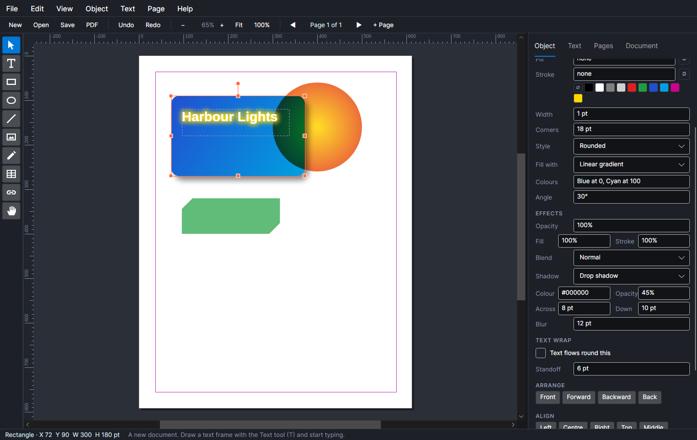

The Object tab's **Effects** go on any object: shapes, text frames, pictures, tables and groups.

- **Fill with**: a colour, or a **linear** or **radial gradient**. Type its **Colours** separated by commas, swatches
  and tints among them, each with **at** and a per cent if it isn't evenly spaced: `Navy, Gold at 60, White`. A
  linear gradient runs at its **Angle** (0° left to right, 90° top to bottom); a radial one out from the middle.
- The **Gradient tool** (D, in the toolbox) sets where a gradient runs by dragging: across an object from where its
  first colour starts to where its last ends, or, for a radial one, out from its centre to its edge. An object with
  no gradient gets one from its fill to white. The selected object's gradient shows as a line, its start a hollow
  dot and its end a solid one: drag either to change it (a radial gradient's centre takes its edge with it). Shift
  keeps the line to steps of 45°.
- **Opacity** makes the whole object see-through, and **Fill** and **Stroke** each on their own.
- **Blend** mixes its colours with what is under it: Multiply darkens (as ink over ink), Screen lightens, and the
  others as in other programs.
- **Shadow**: a **drop shadow** behind it, or a **glow** all round it, in any colour and opacity, with how far
  **across** and **down** it falls and how soft its **Blur** is. A text frame's shadow follows its text.
- **Corners** (rectangles, text frames and pictures): one size for every corner, or four (top left, top right,
  bottom right, bottom left), **rounded** or **cut**. A picture is cut to its corners.

They are drawn the same on screen, in PNGs and in PDFs, where they stay as vector shading and transparency (a
shadow's blur is the one part a PDF carries as a picture).

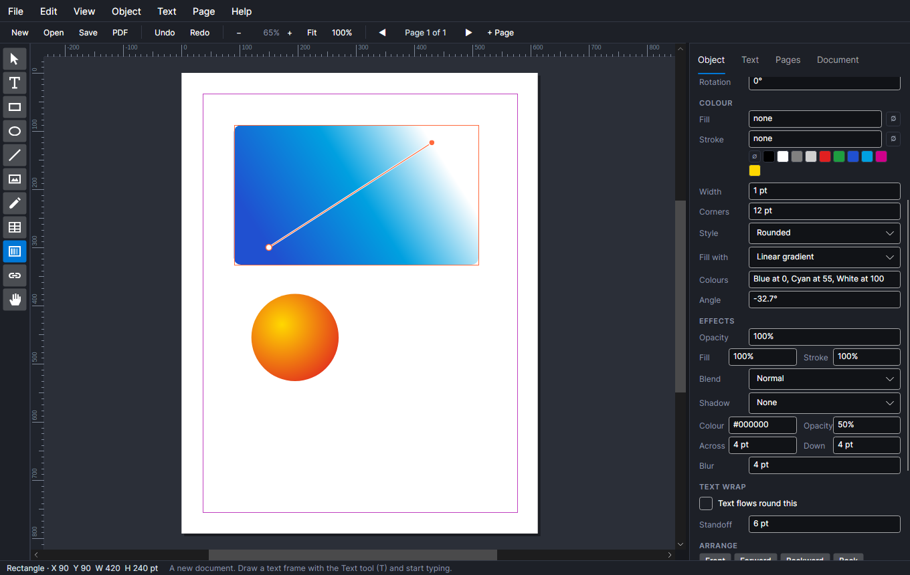

### Object styles

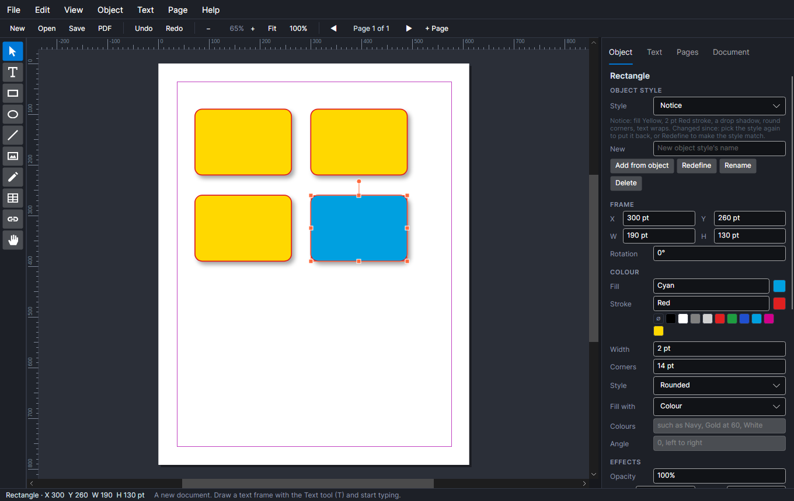

An object style is to shapes and frames what a paragraph style is to text: a named look, kept in the document. It
holds the fill (or gradient), the stroke and its width, opacity, the blend mode, the shadow or glow, the corners and
the text wrap. Its place is at the top of the Object tab.

- **Add from object**: style an object, type a name and click it. The object, and anything else selected, is put in
  the new style.
- **Style**: pick one for the selected objects to take its look; **(none)** takes them out of their style, and they
  keep how they look.
- **Redefine** makes the style match the selected object, and every object in it changes to match.
- **Rename** and **Delete**: deleting an object style leaves its objects looking as they did.

An object changed by hand after it was given its style stays in the style, and the Object tab says it has been
changed since: pick the style again to put it back, or **Redefine** to make the style match it. Redefining puts every
object in the style back to the style's look, changes and all.

### Text on a path

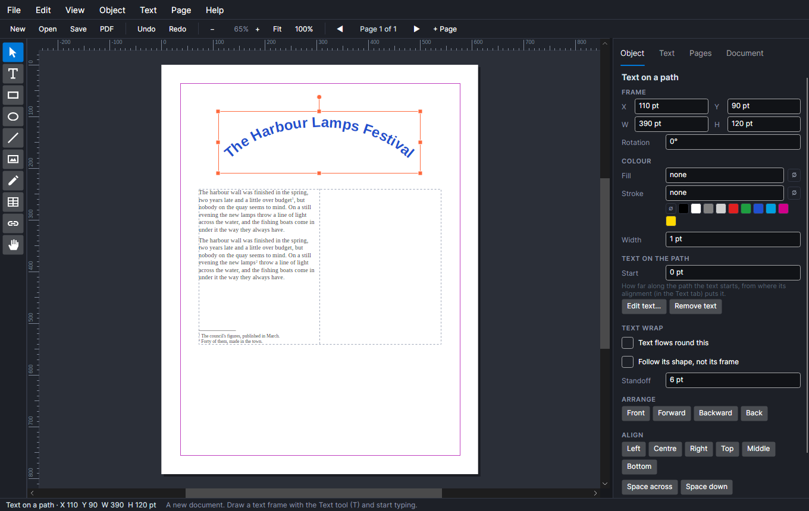

Select a path or polyline and choose Object › **Text on path**: "Text on a path" is set along it, selected, so what you
type replaces it. Each letter sits on the path, turned to follow it. Double-click the letters (or click them with the
Text tool) to type in them again; double-click the path away from its letters to change its points. With the path
selected:

- The **Text** tab sets the type: font, size, colour and the rest. Its **Align** puts the text at the path's
  start (left), in its middle (centre) or at its end (right).
- **Start**, in the Object tab, moves the text along the path from there.
- **Edit text…** (or Ctrl+Shift+E) opens it in the story editor, and **Remove text** takes it off.

Draw the path with no stroke to show the text alone. Text that runs past the path's end isn't shown: the story
editor counts how much. Find and the spelling check go along paths too.

### Text to outlines

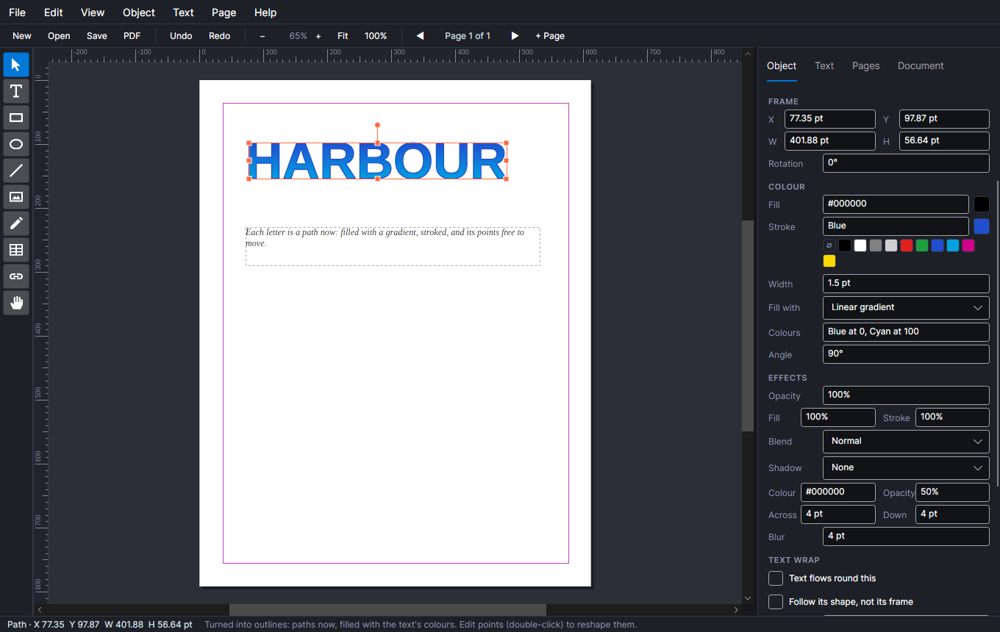

**Object ▸ Text to outlines** (Ctrl+Shift+O) turns text into paths, shaped exactly as the letters were, for a
headline or a logo that has to look the same everywhere, with no font needed to print it. The paths can be filled
(a gradient too), stroked, given effects, and their points moved like any path's (double-click it).

- With **text frames selected**, their text becomes outlines in its place: one path for each colour of text (grouped
  if there are several), with the frame's opacity, blend and shadow. A frame with a fill or a stroke of its own stays
  under them, empty; one without goes. A frame linked to others has to be unlinked first.
- With **some text selected** in a frame, just those letters become outlines, on top of the text. The letters stay in
  the text, made clear, so nothing after them moves; delete them if they aren't needed.

Outlines are no longer text: they can't be edited as words, spelt, or found. Keep a copy of the frame (on a layer that
doesn't print, say) if the words may change.

## Tables

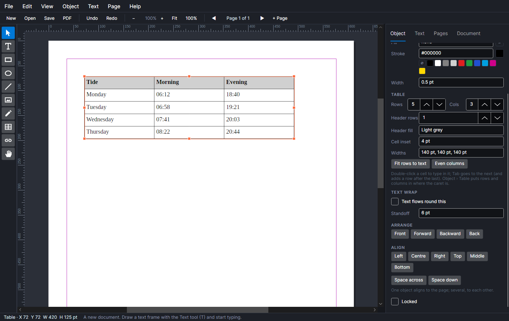

Draw a table with the **Table** tool (G): it starts with four rows and three columns, the first a shaded header row,
and the caret in the first cell. Each cell holds its own text, formatted like any other.

- **Tab** moves to the next cell (Shift+Tab back). Tab in the last cell adds a row.
- Double-click a cell (or click it with the Text tool) to type in it, and click another cell to move there.
- The Object tab sets **Rows** and **Cols** (added or taken from the end), **Header rows** and their **Header fill**,
  the **Cell inset**, and the **Widths** of the columns (`1in, 2in, 1in`). **Even columns** shares the width out.
- Object › Table puts a row in above or below the caret's cell, or a column to its left or right, and deletes the
  caret's row or column.
- Rows keep the height they have. A cell whose text doesn't fit gets a red mark in its corner: **Fit rows to text**
  makes each row as tall as its fullest cell needs.
- The table's stroke draws the rules between and round the cells. Resizing the table scales its rows and columns.

### Tables that run on

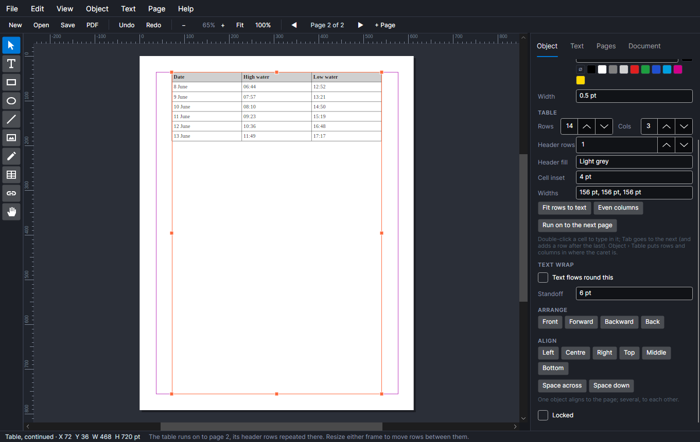

A long table can run on from page to page. Select it (or put the caret in it) and choose Object › Table › **Run on
to the next page**, or click the button of that name in the Object tab. The table stops at the foot of its page's
live area, and a new frame for it is put on the next page (a page is added if there isn't one): the rows that didn't
fit go on there, under the **header rows, drawn again**. Do it again if they still don't all fit.

- Type in a cell in whichever frame shows it. Tab goes on from the last cell of one frame to the first of the next.
- Each frame holds as many rows as fit its height: resize or move a frame and rows move between them. Rows added at
  the end flow on into the last frame; when no frame has room for them, a red mark shows at its foot.
- The table's settings are the same in all its frames; select any of them to change them.
- Deleting a frame it runs on into brings its rows back into the frames before. Deleting the first frame deletes
  the whole table, and copying any frame copies the whole table.

## Colour and swatches

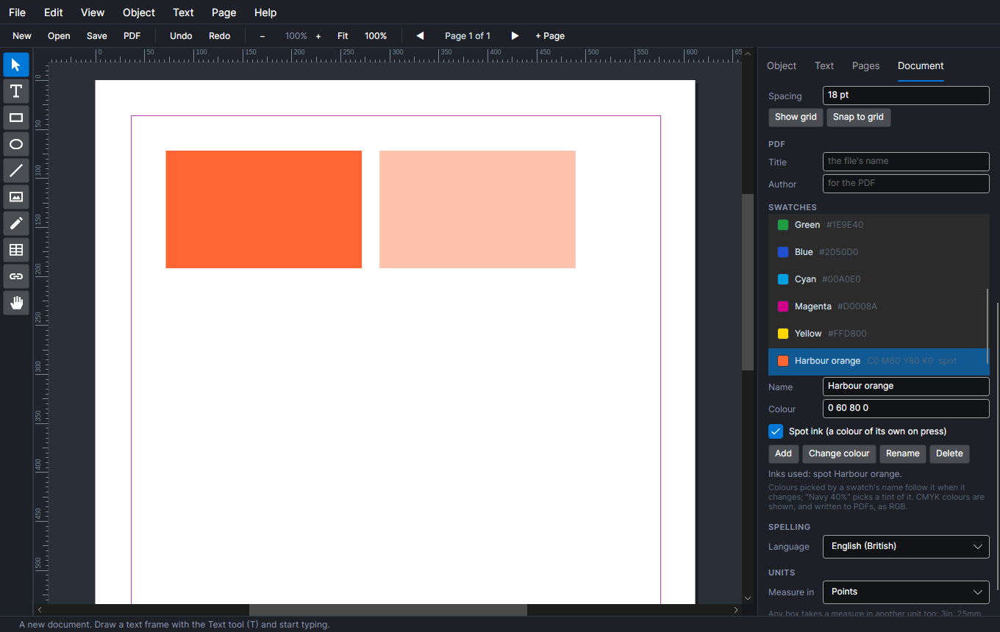

The document keeps a list of named colours, its **swatches** (Document tab › Swatches). Pick a colour by a swatch's
name, by typing it or clicking a swatch button, and it stays tied to the swatch: change the swatch's colour and
everything using it changes. Add **40%** (or any per cent) after the name for a lighter **tint** of it: "Navy 40%".

- **Add** makes a swatch from a name and a colour. The colour can be `#RRGGBB`, or **CMYK** inks in per cents, such as
  `0 60 80 0` (cyan, magenta, yellow, black).
- Tick **Spot ink** for a colour printed as an ink of its own, such as a Pantone colour.
- **Change colour**, **Rename** and **Delete** do as they say. Renaming takes everything using the swatch with it;
  deleting one leaves its colour where it was used.
- **Inks used** tells you what the document needs on press: process colour (CMYK) and the name of each spot ink.

CMYK colours are shown on screen by a plain conversion, and PDFs are written in RGB unless you ask for CMYK or PDF/X when exporting. For exact print colour, tell
your printer which spot inks and CMYK values you mean.

## Rulers, guides and the grid

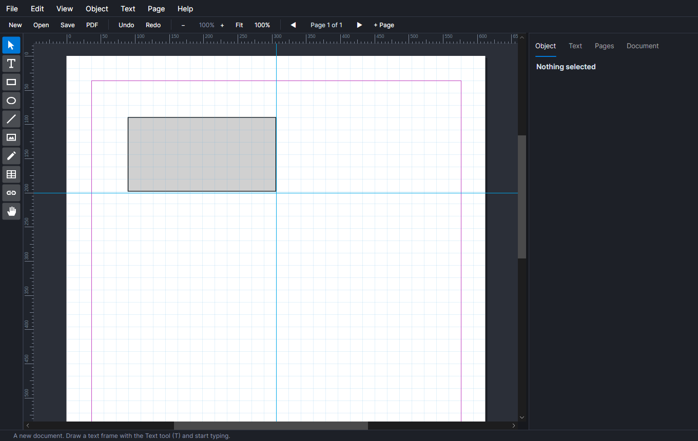

The **rulers** measure from the top-left corner of the page you are working on, in the document's unit, with a mark
following the mouse.

- Drag from a ruler onto the page to make a **guide**: from the top ruler a level one, from the left an upright one.
  Drag a guide to move it, and back onto its ruler to remove it. Guides belong to their page; a master's guides show
  on its pages.
- **Snap** (View › Snap to guides) makes moving, resizing and drawing land on the margins, column edges, guides and
  the page's edges and middle, when within a few pixels of them.
- View › **Show grid** draws the document grid, and **Snap to grid** makes things land on it too. Set its spacing
  in the Document tab (18 pt to start with).
- View › Show guides hides and shows them all.

## Find and replace

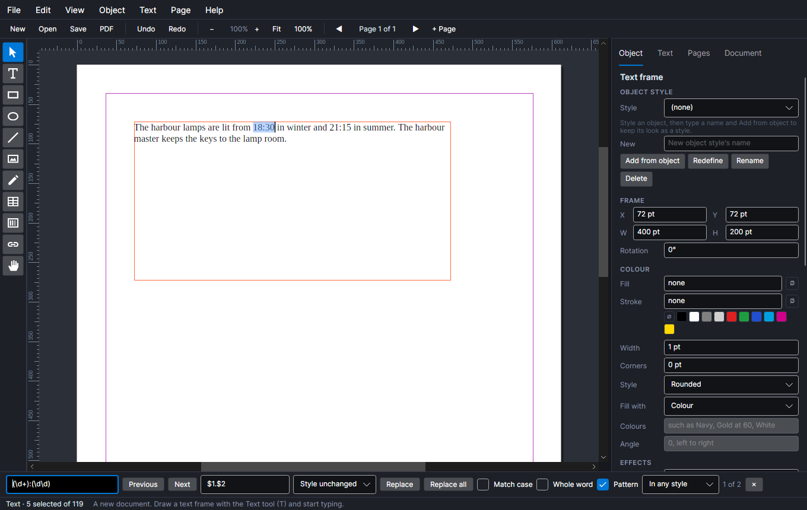

Ctrl+F opens the find bar under the page. Type what to find and press Enter (or F3) for the next, Shift+Enter for
the one before. It looks through every story in reading order, page by page and then the master pages (each
story's footnotes after it, and text on paths where they are), and shows each one selected on its page, with how many
there are. **Match case** and **Whole word** narrow it down.

**Replace** changes the one found and finds the next; **Replace all** changes every one at once, as a single step to
undo. Each replacement takes the look of the text it replaces. Escape closes the bar.

Tick **Pattern** to find a regular expression rather than the words as typed: `.` is any character, `\d` a digit,
`\s` a space, `[a-z]` one of a range, `+` one or more of what's before it, `^` and `$` the start and end of a
paragraph, and brackets make a group. In the replacement, `$1` is what the first group found, `$0` all of it, `\n`
starts a new paragraph and `\t` is a tab. So `(\d+):(\d\d)` replaced with `$1.$2` turns 18:30 into 18.30. A pattern
with a mistake in it says so beside the boxes.

The style list (**In any style**, to begin with) finds only in text of one paragraph style (¶) or character style
(a). With nothing typed to find, it finds each stretch of text in that style: every heading, say, or every word in
Emphasis, one after another.

The list beside the replacement (**Style unchanged**, to begin with) puts what is replaced in a style: a paragraph
style (¶) for the paragraphs it is in, or a character style (a) for the text itself, or *(no character style)* to
take it out of one. With the replacement box empty, the text found is kept and only its style changes: find `Moon`,
pick *a Emphasis* and Replace all, and every Moon is in italics; find `^Note:` as a pattern and pick *¶ Caption* to
put every paragraph starting "Note:" in Caption.

## Spelling

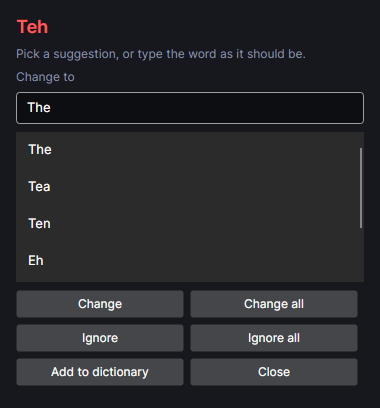

Misspelt words are underlined in red as you type (on screen only, never in print). View › Check spelling as you type
turns that off. The Document tab's **Spelling** sets the language: American or British English.

Text › Check spelling (F7) goes through the document from the caret, word by misspelt word, showing each on its
page:

- **Change** puts in the suggestion picked (or what you type in Change to); **Change all** changes it everywhere.
- **Ignore** passes this one; **Ignore all** passes the word everywhere in this document (and remembers it with the
  document).
- **Add to dictionary** puts the word in your own dictionary, for every document: names, places, words of your
  trade.

Capitalised words and words in capitals are checked as the dictionary has them in lower case, and a name keeps its
capital: "London" is right, "london" isn't.

## The story editor

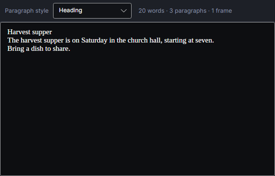

For writing and correcting without the layout in the way, Text › Story editor (Ctrl+Shift+E) opens the story of the
selected frame (or the one you're typing in) as plain text in a window of its own. Type there and the page changes
as you go, the formatting round your changes kept; change the page and it shows there. The paragraph style of the
paragraph you're in is shown at the top, to see and to set, with the story's word count and how much is overset.

## Cross-references

A cross-reference points the reader at another part of the document, "see page 12", and keeps up as pages move.

- Put the caret where it goes and choose Text › **Insert cross-reference…**. Pick a heading (any paragraph in a
  heading style), or a place you have named, and what to show: **its page number**, **its text**, or **its text and
  page** ("Tide tables" on page 12).
- To refer to somewhere that isn't a heading, put the caret there and choose Text › **Name this place…** first.

A reference shows the page as it is numbered (in a section's own numbering, if it has one), and changes when its
place moves to another page or its words change. One whose place has been deleted shows `??`. In PDFs, each is a
link to its place.

## A table of contents

Put the caret where the contents should go (or select an empty text frame) and choose Text › Table of contents….
Tick the paragraph styles to list, the first ticked as the top level: Heading and Subheading, usually. Each
paragraph in those styles becomes a line of the contents, with its page number at the right after a row of dots.
The contents are set in styles of their own, Contents 1, Contents 2 and so on, which you can change like any other.

The contents keep up with the document. Text › **Update contents and index** makes every table of contents and
index again where it is, as one step to undo, going round again if making them moves headings on to other pages.
Exporting and printing do it first, and preflight lists any that are out of date. Choosing Table of contents… with
the caret in a contents (or its frame selected) makes that one again, with the styles you tick, rather than adding
a second. Changes typed into a contents' entries go when it is made again: change its Contents styles instead.

## An index

Mark each place a topic is discussed, then make the index from the marks.

- Select the word or words the entry is for (or just put the caret there) and choose Text › **Mark index
  entry…** (Ctrl+Alt+I). The topic starts as the selected words; change it if you like, so that "tidal" and
  "tides" can both be filed under Tides. Give a **sub-topic** to file the entry under the topic, indented: Tides,
  then neap and spring. Give a **see** topic to send the reader elsewhere instead of to a page: "Launch. See
  Harbour master." The mark itself is invisible and takes no room.
- Put the caret where the index should go (in a frame of two or three columns, usually) or select its frame, and
  choose Text › **Index**.

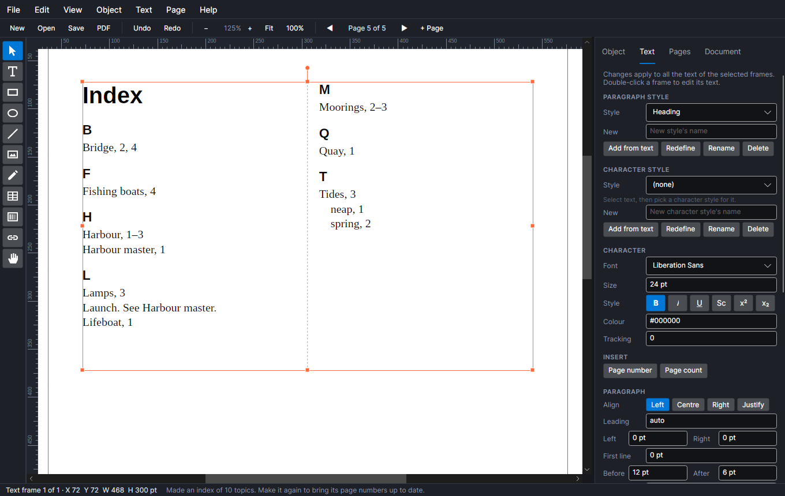

Topics are sorted alphabetically under a heading for each letter (topics that don't start with a letter go under
#), whatever their capitals. A topic found on pages 1, 2 and 3 shows as 1–3, by the pages' own numbering. A topic
with pages and a see shows "See also". The index is set in styles of its own, Index Heading, Index 1 and Index 2,
which you can change like any other. Like a table of contents, it keeps up: Text › **Update contents and index**,
exporting and printing make it again with the pages as they are then.

## Templates

A template is a document to start others from: a newsletter's masthead and columns, a parish magazine's masters and
styles. File › Save as template… saves the document as one, and File › New from template starts a new, untitled
document from it. Two come with the program:

- **Newsletter**: a Letter page with a masthead, two linked columns and page numbers in the footer.
- **Booklet**: eight A5 facing pages with one story running through them all, and page numbers on the outside
  corners.

Templates saved in the templates folder (where Save as template starts) are listed on the menu; any `.avpt` file can
be opened as a template with A template file….

## Saving, exporting and printing

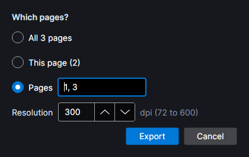

**Saving.** Ctrl+S saves, Ctrl+Shift+S saves under a new name. Saving writes the new file before it replaces the old
one, so a failed save never damages your work. The title bar shows a dot while there are changes not saved, and
closing asks first. File › Open recent lists the last ten documents. Undo (Ctrl+Z) and redo (Ctrl+Y) go all the way
back to when the document was opened.

**PDF.** File › Export PDF… (Ctrl+E) writes the pages as a PDF, with its fonts inside it, ready to send to a printer
or post online. Choose all the pages, the one shown, or a range such as `1-3, 7`. The PDF also has:

- the document's **title and author** (Document tab);
- a **bookmark** for each heading, so a reader can jump about: paragraphs in Heading, and under them in
  Subheading (and in any styles of your own named "Heading 2", "Heading 3" and so on), open beside the pages;
- **links** from each entry of a table of contents to its heading's page, and from every web address in the text
  (`https://…` or `www.…`) to the web.

**CMYK, for a press.** Tick **In CMYK** when exporting a PDF and its colours are written as the inks they print with:
a CMYK swatch's own inks, a spot swatch as its own ink at its tint, and every other colour converted to CMYK so it
looks the same on screen. Pictures are converted too, except JPEG photographs, which stay in RGB rather than lose
quality; the status bar says if there are any.

**PDF/X-4, for a printer.** Tick **PDF/X-4** for a file to hand to a print shop. It is the standard their checks
look for (ISO 15930-7): everything in CMYK or spot inks, JPEG photographs too (converted, and kept without loss);
an *output intent* saying how the CMYK was made, as an ICC profile of AVAPageStream's own conversion, so the shop's
software knows exactly what the colours mean; the document's title and the standard named in its metadata; a trim
box on every page (and the bleed box, with crop marks); fonts embedded; transparency kept, blended in CMYK. Links
are left out, as PDF/X doesn't allow them on the page. If your printer asks for a particular printing condition
(such as FOGRA39 or GRACoL), ask whether this file will do, or have them convert it: AVAPageStream's CMYK is a plain
conversion, not a press's.

Before exporting or printing, if preflight finds problems that will show in print, it asks whether to go on, or
shows them. To stop it asking, untick **Ask before exporting or printing** in the preflight window.

**PNG.** File › Export PNG… writes each page as a picture, at a resolution from 72 to 600 dots an inch. Several pages
go to numbered files: `leaflet-1.png`, `leaflet-2.png`.

**Printing.** File › Print… (Ctrl+P) sends the pages to your printer through the computer's own printing (on Linux
and macOS, the `lp` command).

**Printing to the edge.** A printer can't print right to the edge of the paper, so artwork meant to run off the edge
is printed on bigger paper and cut down. Give the document a **Bleed** (Document tab), let pictures and boxes that
should reach the edge run out past it to the red dashed line, and tick **Crop marks and bleed** when exporting the
PDF. Each page is then set on a sheet with room round it, its artwork out to the bleed, and short **crop marks** at
the corners showing where to cut. The PDF also says where the trim and bleed are (its trim and bleed boxes), which a
print shop's software reads.

**Booklets.** Tick **As a booklet** when exporting a PDF or printing, and the pages are arranged two to a sheet in the
order that folds into a stapled booklet. Page 8 goes beside page 1, page 2 beside page 7, and so on, with blank pages
added to make a multiple of four. Print both sides of the paper, flipping on the short edge, fold the stack in half
and staple it on the fold.

## Preflight and packaging

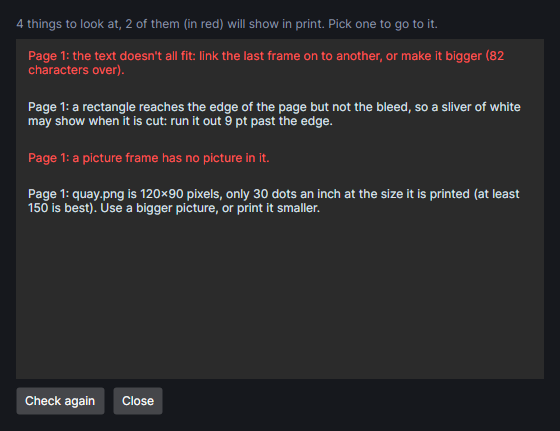

**Preflight** (File › Preflight…) checks the document for what would go wrong in print, and lists it, the problems
that will certainly show in red:

- text that doesn't all fit its frames, a table's cell, or its path, and table rows with no frame to go in;
- picture frames with no picture, and linked pictures whose files are missing or have changed;
- pictures with too few pixels for the size they are printed at: under 150 dots an inch, a photograph looks soft or
  blocky (an SVG drawing prints sharp at any size; in an EPS, the pictures inside it are checked);
- filled shapes and pictures that reach the edge of the page but not out to the bleed (or, with no bleed set, that
  run to the edge at all);
- fonts that aren't on this computer (their text is set in Liberation Serif), and fonts whose licence doesn't allow
  them to be put in a PDF.

Click an entry to go to it: its page is shown and the object selected, or the caret put where the text stops fitting.
**Check again** looks again after you have put things right. Layers that are hidden or don't print aren't checked.

**Package** (File › Package…) gathers everything the document needs into one new folder, named after it, in the
folder you pick, ready to hand to a printer or take to another computer:

- a copy of the document, its linked pictures copied into **Links** and the copy linked to them there;
- the font files of the fonts it uses, in **Fonts** (the Liberation fonts are inside AVAPageStream, so they aren't),
  found in the system's font folders or, where they are installed elsewhere, through fontconfig or Windows' list of
  fonts;
- **Report.txt**: the page size and bleed, the pictures, the fonts and where they came from, the inks it prints
  with, what preflight found, and anything that couldn't be found.

## Footnotes

Put the caret where a footnote's number goes and choose Text › **Insert footnote** (Ctrl+Alt+F). A small raised
number goes in the text, and the caret goes into the note itself, at the foot of the column, after the same number,
for you to write it; Escape goes back to the text. Notes
are numbered from 1 through their story, in the order their numbers come, and renumber themselves as notes are put in
or taken out.

Each note is set at the **foot of the column** its number is in, under a short rule, and the column's text stops
above it. If a line's note won't fit under it, the line goes on to the next column with its note. Footnotes are in
the **Footnote** paragraph style (9 pt to start with), which you can change like any other.

- To change a note, double-click it at the foot of the column (or click it with the Text tool), or put the caret
  beside its number and choose Text › **Edit footnote**. Ctrl+Shift+E opens it in the story editor.
- Deleting a note's number deletes the note. Copying text or frames with numbers in them copies their notes too.
- Find and the spelling check go through footnotes too, each story's after its text.

## Autosave and recovery

Every two minutes, a document with changes not yet saved is copied to the Recovery folder (see *Where things are
kept*). Saving or closing it removes the copy. If the program stops without saving (a crash, a power cut), the next
time it starts it offers the work it saved: **Recover** opens it, as a document with changes still to save under its
own name; **Discard** throws the copy away; **Not now** keeps it to be offered next time.

## Keyboard

| Keys | |
| --- | --- |
| V, T, R, E, L, P, B, G, K, H | The tools (when not typing) |
| Ctrl+N, Ctrl+O, Ctrl+S, Ctrl+Shift+S | New, open, save, save as |
| Ctrl+E, Ctrl+P | Export PDF, print |
| Ctrl+Z, Ctrl+Y | Undo, redo |
| Ctrl+X, Ctrl+C, Ctrl+V | Cut, copy, paste (objects, or text while typing) |
| Ctrl+D | Duplicate |
| Ctrl+G, Ctrl+Shift+G | Group, ungroup |
| Ctrl+], Ctrl+[ | Bring forward, send backward (with Shift: to the front, to the back) |
| Arrows | Nudge by a point (with Shift: ten) |
| Ctrl+A | Select everything on the page (or the whole story while typing) |
| Ctrl+0, Ctrl+1, Ctrl+wheel | Fit the page, actual size, zoom |
| Page Up, Page Down | The previous and next page (while typing, the previous and next frame) |
| Ctrl+B, Ctrl+I, Ctrl+U | Bold, italic, underline |
| Alt+Left, Alt+Right | Kern tighter, looser |
| Ctrl+Shift+3 | Insert a page number |
| Ctrl+Alt+F | Insert a footnote |
| Ctrl+F, F3, Shift+F3 | Find and replace, find the next, the one before |
| F7 | Check spelling |
| Ctrl+Shift+E | The story editor |
| Tab | In a table, the next cell |
| Space (held) | Slide the page about |
| Escape | Stop typing; then let go of the selection; or give up a drag |

Help › Keys and tools has the short version.

## Where things are kept

Your settings, your own dictionary (`words.txt`), your templates and the Recovery folder of autosaved work are kept in the AVAPageStream folder of your
user settings: `~/.config/AVAPageStream` on Linux and macOS, and `%APPDATA%\AVAPageStream` on Windows.
